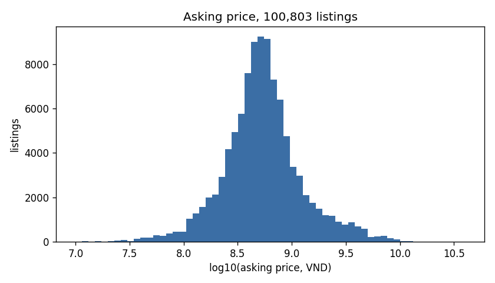
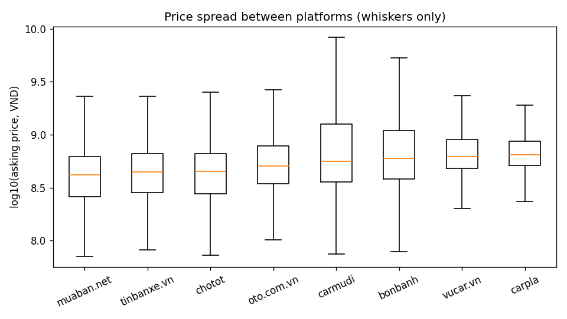
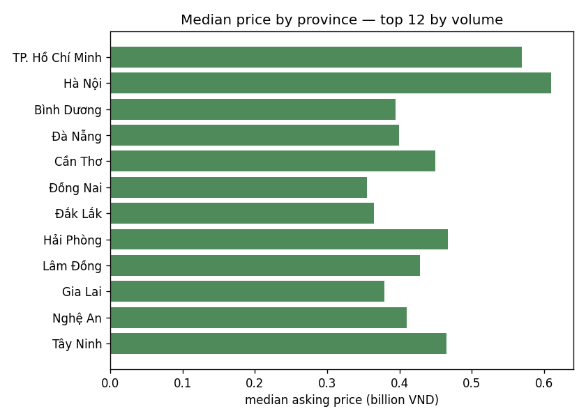
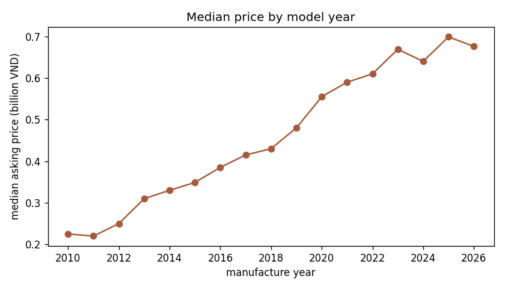
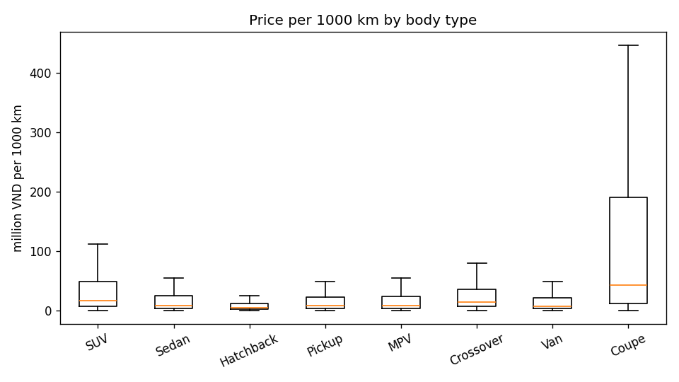

# Week 3 report — used-car valuation and listing screening

## Abstract

We built a used-car price guide and a listing-screening layer for the Vietnamese market from **100,887
listings across eight platforms**, frozen as a snapshot on 31 October 2026. Prices are modelled as
`log1p(price_vnd)` and split by duplicate group rather than by row, so a car cross-posted on four sites
cannot appear on both sides of the split. On the held-out validation split (14,964 listings) a tuned
LightGBM on the full feature set reaches **R²(log) 0.9471** with **MAPE 11.4%** and a **median absolute
percentage error of 6.2%** — a typical listing is priced within about 6% of its asking price, and the
median baseline (0.8773) is beaten by seven points. The **test split was scored exactly once**, after the
model and its parameters had been frozen: **R²(log) 0.9487, MAPE 10.9%, median APE 6.1%**, and the 80%
price interval covered **81.9%** of asking prices. The same quantile band, combined with an Isolation
Forest, assigns every validation listing one of four labels: **81.7% Fair, 8.9% Bargain, 8.9%
Overpriced, 0.6% Suspicious** — 83 listings for a human to read, which is the point of the screening
layer. Two findings matter more than the score. First, the ceiling is **data, not modelling**: nine model
families sit inside 0.937–0.947, fifty tuning fits buy +0.0009, and the learning curve is still rising at
70,000 rows. Second, the honest headline is **not** the leaderboard: `Bargain` is not a buy signal, the
worst errors are deposit-style prices rather than model failures, and any future model change must be
reported as a limitation because the holdout has been spent.

Every number below is the value its artefact produced on the frozen splits. Nothing was re-run,
re-selected or rounded toward a nicer figure after the test split was opened; §8.2 names the one place
where a validation-selected number is optimistic, and by how much.

## Headline numbers

| | Value | Section |
| --- | --- | --- |
| Model shipped | LightGBM, `full` features, frozen tuned parameters | §5.1 |
| Validation (14,964 listings) | R²(log) **0.9471** · MAPE **11.4%** · median APE **6.2%** · MAE **82.1 million VND** | §5.1 |
| Test (14,980 listings, evaluated once) | R²(log) **0.9487** · MAPE **10.9%** · median APE **6.1%** · MAE **89.7 million VND** | §5.2 |
| 80% price interval on test | covers **81.9%** of asking prices | §5.2, §7 |
| Listings flagged on val | **8.9%** Bargain · **8.9%** Overpriced · **0.6%** Suspicious | §7 |
| Canary floor (`median` 0.8773 → floor 0.946) | beaten by **+0.0011** R² and **−0.2** points MAPE — real, and small | §5.1, §8.2 |

| Section | Numbers come from | Command that regenerates them |
| --- | --- | --- |
| 1 Pipeline | `split_summary.json` | `python -m src.data_prep.pipeline` |
| 2 Data quality | `missing_report.json`, `normalize_report.json` | `python -m src.data_prep.missing` |
| 3 EDA | `docs/eda_summary.md` + 5 figures | `python -m tools.eda_summary` |
| 4 Features | `feature_ablation.json`, `cardinality_study.json`, `model_extras.json` | `python -m src.features.build_features --ablate` · `python -m tools.model_extras` |
| 5.1 Benchmark | `docs/benchmark.md` | `python -m src.models.benchmark` |
| 5.2 Test | `docs/test_evaluation.md` | `python -m src.models.train --split test --at-m2` |
| 6 Errors | `docs/error_taxonomy.md`, `docs/case_studies.md` | `python -m tools.error_report` |
| 7 Labelling | `anomaly_labels.csv`, `anomaly_thresholds.json` | `python -m src.models.anomaly` |
| 8 Limitations | — | — |
| 9 Conclusions | — | — |
| A Reproduction | — | `python -m tools.clean_check` |
| B Artefact inventory | `data/master/*` | see the table in B |
| C Metric glossary | — | — |

## 1. Pipeline

The dataset was frozen on 31 October and is not touched again: `master_clean_dataset.csv` (100,887 rows)
→ `src.data_prep.pipeline` (split by `duplicate_group_id`, seed 42) → cohort selection and imputation →
feature tables `{train,val,test}_features_{minimal,full}.csv`. The split lands at **70.1% / 14.93% /
14.97%** (70,244 / 14,964 / 14,980 rows once features are built), with **75,496 duplicate groups**, none
of which straddles two splits — so a car cross-posted on four sites cannot appear in both train and val.

Four gates run before a number is allowed into this report:

| Gate | Command | Result on this snapshot |
| --- | --- | --- |
| Merged dataset | `python -m tools.audit_master` | see the last run log |
| Source contract | `python -m tools.validate_source_csv` | PASS per source |
| Feature leak | `python -m tools.model_gate` | PASS — no forbidden column, no copy of the target, partitions share one column set, no group straddles a split |
| Unit tests | `python -m unittest discover -s tests` | 180 tests, OK (2026-11-08) |

Models fit `log1p(price_vnd)`; every metric is reported in **both** log and VND space so no model can
show only the flattering one. The test split is evaluated **once** (§5.2).

## 2. Data quality

- **100,887 rows** in the master, **100,868 with a price**; the 19 without one are dropped rather than
  imputed — you do not invent the target.
- **75,496 duplicate groups** for 100,887 listings, so cross-posting is real. Splitting by group is what
  keeps val and test from being inflated by the same car listed on several sites.
- **Missing rates on train**: `engine_capacity` **61.2%**, `sub_model_trim` **55.7%**, `seller_type`
  **34.1%**, `origin` **28.6%**, `seats` **21.3%**, `body_type` **18.6%**, `mileage_km` **12.7%**,
  `fuel_type` 0.7%, `transmission` 1.5%. The first two are a real limit on what the model can do, not an
  implementation detail — see `docs/data_limitations.md`.
- **Brand canonicalisation**: 164 spellings collapse to **146 brands** (`Hyundai`/`HYUNDAI`,
  `Mercedes Benz`/`Mercedes-Benz`, `VinFast`/`Vinfast`, `LandRover`/`Land Rover`). Without this step the
  brand column is noise and 18 brands are split in two.
- **10,906 train rows** carry at least one `quality_flags` entry. The model never sees the flag (it is
  forbidden as a feature), so those rows are learned as ordinary rows — the flag is a judgement about the
  listing, not a property of the car.
- **Price distribution (train)**: median 520 million, P10 199 million, P90 1.479 billion VND.
- **Volume by source**: bonbanh 21,223 · oto.com.vn 20,764 · chotot 13,631 (19,428 overall) · tinbanxe
  5,355 · muaban 4,921 · carpla 2,932 · vucar 1,515 · **carmudi 366**.

## 3. What the data looks like (EDA)

Source: `data/master/master_clean_dataset.csv` — **100,887 listings** before the price window and
**100,803** after keeping 10 million – 50 billion VND (84 rows dropped, 0.08%, all deposit-style
placeholders or typos; the raw maximum is 465 trillion VND). Provinces are canonicalised before anything
is counted (case- and diacritic-insensitive folding plus an alias table), otherwise `TP HCM` and
`TP.HCM` become two markets and every regional number is wrong.

### 3.1 Five figures, and the number each one has to justify

| Figure | What it shows | The number to remember |
| --- | --- | --- |
| `fig1_price_distribution.png` | price distribution | right-skewed even inside the window ⇒ every model fits `log1p(price_vnd)`, and R²(VND) always looks better than R²(log) |
| `fig2_price_by_source.png` | median price by platform | 420 million (muaban.net) → 645 million (carpla): **×1.54** |
| `fig3_price_by_province.png` | median price by province | TP.HCM 38,271 + Hà Nội 33,079 = **71%** of volume; top-12 median spread **×1.7** |
| `fig4_price_by_year.png` | median price by model year | 225 million (2010) → 699 million (2025), rising almost monotonically |
| `fig5_price_per_km_by_segment.png` | price per 1,000 km by segment | segments spread **×9.4** on price per km against **×3.5** on absolute price |

**Figure 1 — price distribution.** The right tail survives the price window, which is why every model in
§5 fits a log target.



**Figure 2 — median price by platform.** A factor of 1.54 between the cheapest and dearest platform with
at least 500 listings.



**Figure 3 — median price by province.** The two largest markets carry 71% of the volume; the top-12
median spread is 1.7×.



**Figure 4 — median price by model year.** The depreciation curve the model has to learn, 2010–2026.



**Figure 5 — price per 1,000 km by segment.** Segments spread 9.4× on this ratio against 3.5× on
absolute price, so mileage does not normalise a segment away.



### 3.2 Three readings that change later sections

1. **Price per km separates segments more than absolute price — and mileage is still a weak signal.**
   Across the ten segments with at least 900 listings, price per 1,000 km runs from 4.6 million
   (Hatchback) to 42.7 million (Coupe), **×9.4**, while absolute price runs from 265 million to 934
   million, **×3.5**. Mileage does not "normalise" a segment away. For the model, §4.2 measures what
   dropping `mileage_km` and `km_per_year` costs: **ΔR² 0.0001**.
2. **`body_type` is missing on 18.2% of the window (18.6% of train)** — a fifth of the market cannot be
   assigned to a segment at all, so every "by segment" statement here is about the other 82%.
3. **Small platforms differ in distribution, not only in volume.** carmudi has 546 listings, vucar 2,124,
   carpla 4,179 — yet carpla's median asking price is 1.54× muaban's. That is why §6 reports error per
   platform instead of one MAPE, and why §8.1 says carmudi is too small to be a segment of its own.

### 3.3 What the model cannot see

Asking price rather than transaction price; no accident, service, ownership or legal history; four rows
carry a model year that cannot be real (1025, 2028, 2030, 2032) and nine have none; `engine_capacity` is
missing on 61.2% of train, so a large share of cars cannot be told apart by displacement. These are
carried into §6 and §8.1 rather than treated as noise.

## 4. Features

### 4.1 Two tables, one whitelist

- **minimal** — raw columns plus vehicle age: `manufacture_year`, `mileage_km`, `engine_capacity`,
  `seats`, `vehicle_age`, and the original categoricals.
- **full** — adds `km_per_year`, `engine_per_seat`, `age_band`, `brand_age_band`, `is_luxury_segment`
  (a brand list, **not** a price rule), `province_group`, `brand_retention_rate`, `province_price_index`,
  `n_imputed`.

Every statistic used to build a feature (encoders, price indices, retention rates) is fitted on **train
only** and applied to val/test; `tools.model_gate` then checks the result for a leaked or copied target.

### 4.2 Group ablation — what each feature group is worth

Drop-one-group, Ridge on 20,000 rows as assigned; ΔR² is the fall in R²(log) when the group is removed,
against a **0.9184** baseline:

| Group dropped | Columns | R²(log) left | ΔR² |
| --- | --- | ---: | ---: |
| timing | `manufacture_year`, `vehicle_age`, `age_band`, `brand_age_band` | 0.7904 | **+0.1280** |
| cat_identity | `brand`, `model`, `model_group` | 0.8656 | **+0.0528** |
| cat_spec | `transmission`, `fuel_type`, `origin`, `body_type`, `seller_type` | 0.9109 | +0.0075 |
| size | `engine_capacity`, `engine_per_seat`, `seats` | 0.9149 | +0.0035 |
| source | `source_platform` | 0.9154 | +0.0030 |
| flags | `n_imputed`, `is_luxury_segment` | 0.9169 | +0.0015 |
| usage | `mileage_km`, `km_per_year` | 0.9183 | +0.0001 |
| geo | `province_group`, `province_price_index`, `brand_retention_rate` | 0.9187 | −0.0003 |

Two readings, both against the initial expectation, so both are stated plainly:

1. **Age and identity are 90% of the value** (ΔR² 0.1280 + 0.0528). Dropping mileage moves R² by
   0.0001 — odometer readings are not a pricing signal in this dataset, however intuitive they feel.
2. **The geo group contributes nothing** (ΔR² slightly negative). This matches the decision to keep the
   two price statistics out of the default preprocessor: dropping them costs nothing and removes a target
   leak waiting to happen.

### 4.3 Cardinality: categorical beats target encoding here

`docs/cardinality_research.md` (LightGBM on 20,000 rows, only the brand/model encoding changes):
`brand`+`model` as categorical **0.9319** · `model_group` **0.9313** · `model` **0.9304** · out-of-fold
target encoding **0.9178**. At this cardinality (1,912 models, 103–146 brands) target encoding does **not**
win; it is a variance-control choice for linear models, not an accuracy gain, and this report says so
instead of presenting it as a technique that paid off.

### 4.4 What the fitted model actually uses

From `tools.model_extras` (its own LightGBM run: R²(log) 0.9458, MAPE 11.6% on val):

| Feature | Permutation importance (RMSE, log space) | sd |
| --- | ---: | ---: |
| `brand_age_band` | 0.5096 | 0.0812 |
| `manufacture_year` | 0.2621 | 0.0362 |
| `model` | 0.2314 | 0.0392 |
| `model_group` | 0.1803 | 0.0353 |
| `brand` | 0.1317 | 0.0210 |
| `engine_capacity` | 0.1301 | 0.0244 |

The top four are "what car, which year" — the same story the ablation tells from the other side. Partial
dependence agrees: holding `manufacture_year` at 2011 predicts 493 million, at 2021 793 million, at 2025
858 million.

**Seed stability** (3 seeds, 20,000 rows, 300 trees): 0.9305 / 0.9312 / 0.9308 → mean **0.9308 ± 0.0003**.
That ±0.0003 is why §5.1 needs a paired test rather than a bare ranking: differences below ~0.001 are the
noise floor of a re-run.

**Learning curve** (7,024 / 17,561 / 35,122 / 70,244 train rows): 0.8947 → 0.9107 → 0.9311 → 0.9440. Still
rising at the last point, so the ceiling here is **data and features**, not model capacity — the strongest
single argument against spending another day on hyperparameters.

## 5. Models

### 5.1 Benchmark on val (14,964 rows)

Nine model families × two feature sets. Three combinations were tuned inside a **600 s budget, 25 draws ×
2 grouped folds = 50 fits**; everything else uses fixed parameters, and the `tuning` column of
`docs/benchmark.md` marks each row. Every number here is on **val**; the test split appears only in §5.2.

| Features | Model | R²(log) | RMSE(log) | R²(VND) | MAE (VND) | MAPE | MAPE clean | median APE | s | tuning |
| --- | --- | ---: | ---: | ---: | ---: | ---: | ---: | ---: | ---: | --- |
| full | **lightgbm+tuned** | **0.9471** | 0.1904 | 0.9215 | 82,087,205 | 11.4% | 10.3% | 6.2% | 468.5 | 25×2 |
| full | catboost | 0.9465 | 0.1914 | 0.9134 | 91,143,312 | 12.0% | 10.9% | 6.9% | 447.8 | fixed |
| minimal | lightgbm+tuned | 0.9464 | 0.1916 | 0.9162 | 84,155,488 | 11.6% | 10.4% | 6.3% | 138.8 | 25×2 |
| full | lightgbm | 0.9462 | 0.1919 | 0.9213 | 82,441,420 | 11.5% | 10.4% | 6.3% | 16.7 | fixed |
| minimal | lightgbm | 0.9447 | 0.1945 | 0.9151 | 84,885,802 | 11.7% | 10.6% | 6.4% | 5.4 | fixed |
| full | **xgboost+tuned** | 0.9440 | 0.1957 | 0.9010 | **78,041,635** | **11.0%** | **9.8%** | 5.9% | 326.7 | 25×2 |
| minimal | catboost | 0.9438 | 0.1961 | 0.9056 | 95,474,212 | 12.3% | 11.2% | 7.1% | 264.8 | fixed |
| minimal | xgboost+tuned | 0.9413 | 0.2004 | 0.8983 | 80,995,302 | 11.3% | 10.1% | 6.2% | 269.4 | 25×2 |
| full | rf | 0.9411 | 0.2008 | 0.9094 | 87,698,367 | 12.1% | 10.7% | 6.4% | 149.8 | fixed |
| full | xgboost | 0.9409 | 0.2011 | 0.8952 | 78,256,273 | 11.1% | 9.8% | **5.7%** | 22.3 | fixed |
| minimal | catboost+tuned | 0.9395 | 0.2035 | 0.8962 | 100,674,556 | 13.0% | — | 7.5% | 308.7 | 1×2 |
| minimal | xgboost | 0.9388 | 0.2046 | 0.8914 | 80,850,994 | 11.3% | 10.1% | 6.0% | 11.2 | fixed |
| minimal | rf | 0.9370 | 0.2076 | 0.8960 | 94,182,039 | 12.6% | 11.2% | 6.7% | 120.8 | fixed |
| full | ridge | 0.8970 | 0.2655 | 0.8200 | 141,897,201 | 18.0% | 16.4% | 10.4% | 6.1 | fixed |
| full | median (baseline) | 0.8773 | 0.2899 | 0.8703 | 101,649,813 | 18.8% | 13.2% | 7.3% | 1.8 | fixed |
| minimal | ridge | 0.8746 | 0.2930 | 0.7824 | 157,731,450 | 20.6% | 18.6% | 11.5% | 4.5 | fixed |
| full | elasticnet | 0.8722 | 0.2958 | 0.7458 | 174,713,377 | 21.2% | 19.3% | 13.4% | 90.5 | fixed |
| full | lasso | 0.8561 | 0.3139 | 0.7136 | 190,664,684 | 22.9% | 20.9% | 14.8% | 37.4 | fixed |
| full | knn | 0.8553 | 0.3147 | 0.7387 | 181,201,164 | 22.8% | 20.8% | 13.4% | 1.5 | fixed |
| minimal | elasticnet | 0.8507 | 0.3198 | 0.7138 | 192,621,090 | 23.7% | 21.5% | 14.7% | 17.4 | fixed |
| minimal | knn | 0.8372 | 0.3338 | 0.7273 | 194,474,953 | 25.9% | 23.5% | 14.8% | 1.1 | fixed |
| minimal | lasso | 0.8344 | 0.3367 | 0.6868 | 207,337,967 | 25.5% | 23.1% | 16.2% | 19.4 | fixed |

`MAPE clean` drops the rows whose asking price is below a quarter of the estimate — the deposit-style
listings §6 is about. One early row (`minimal`/`catboost+tuned`) predates that column and shows `—`. The
two `median` rows carry identical numbers because the baseline ignores the feature set: a "model" that
only knows the global median already sits at R²(log) 0.8773.

**Pre-declared primary metric: R²(log)** — the quantity the models minimise and the quantity the canary
floor is expressed in. It is fixed *before* the table is read, because the metric decides the winner:

1. **The canary floor is 0.946 R²(log) / 11.6% MAPE; the best row is 0.9471 / 11.4%.** It clears both, but
   by +0.0011 and −0.2 points. There is no step change from complexity: untuned LightGBM lands on
   0.9447–0.9462, i.e. *on* the floor, so the claim "the complexity is justified" rests on the tuned row.
2. **Tuning buys very little: +0.0009 R²** (0.9462 → 0.9471) for 50 fits and 16.7 s → 468.5 s. A paired
   Wilcoxon on absolute percentage error says the difference is real (p = 7.8e-05) against a seed sd of
   0.0003 — real, and irrelevant to a user.
3. **CatBoost and LightGBM tie** (0.9465 vs 0.9462 untuned). Wilcoxon prefers catboost (p = 2.3e-15) while
   R² differs by 0.0003 — one seed sd — and catboost is *worse* on MAPE (12.0% vs 11.5%).
4. **XGBoost wins in VND space and loses on ranks.** `xgboost+tuned` has the best MAE (78.0 million), MAPE
   (11.0%), clean MAPE (9.8%) and median APE (5.9%), yet the paired Wilcoxon against `lightgbm+tuned` calls
   it **worse** (p = 5.8e-12). Both are true: it wins on expensive cars and loses by small margins on the
   many cheap ones. That is why the primary metric is declared up front instead of after the table.
5. **The median baseline beats ridge on median APE** (7.3% vs 10.4%) while scoring lower on R² (0.8773 vs
   0.8970). A linear model that looks better by R² is worse in the middle of the distribution — the wrong
   conclusion the median-APE column exists to block.

`full` beats `minimal` by about 0.0015 R² on the untuned pair (0.9462 vs 0.9447): small, real (Wilcoxon
p = 7.4e-07) against a 0.0003 noise floor, and not to be described as a large improvement.

**Model used for the artefacts** (`predictions_{val,test}.csv`): **lightgbm+tuned / full**, parameters
frozen as `n_estimators=900, learning_rate=0.03, num_leaves=63, min_child_samples=20`. Re-running through
`--params` reproduces **0.9471 / 0.1904 / 82,087,205 / 11.4%** exactly, in 31.9 s instead of 468.5 s, so
the artefact is reproducible without repeating the search. LightGBM was preferred over catboost because its
MAPE is better (11.4% vs 12.0%) and it emits quantiles directly, so the P10/P90 band of §7 needs no third
model.

### 5.2 Test — the single evaluation

The test split was scored **once**, after the model and its parameters were frozen. The record is
`docs/test_evaluation.md`; the interval check is `docs/intervals_test.md`.

| Metric | val (14,964) | **test (14,980)** |
| --- | ---: | ---: |
| R²(log) | 0.9471 | **0.9487** |
| RMSE(log) | 0.1904 | 0.1869 |
| R²(VND) | 0.9215 | 0.9026 |
| MAE (VND) | 82,087,205 | 89,731,484 |
| MAPE | 11.4% | **10.9%** |
| MAPE clean | 10.3% | 10.1% |
| median APE | 6.2% | 6.1% |
| band coverage (nominal 80%) | 81.70% | **81.91%** |

Three things follow from that table:

1. **The test split is not suspiciously easy.** R²(log) and MAPE come out 0.0016 / 0.5 points *better*
   than val — inside the variation between two splits of one distribution, not evidence that the holdout
   was lucky.
2. **MAE and R²(VND) move the other way** (89.7 vs 82.1 million; 0.9026 vs 0.9215) because they are
   absolute-VND quantities and the test mix is more expensive. One model, opposite readings — the lesson
   of §5.1 repeated on held-out data.
3. **The band carries over** — 81.91% against a nominal 80%, split as 8.62% below P10 and 9.47% above P90 —
   so calibrating on train OOF did not overfit the band to val.

What is **not** allowed now: re-tuning, re-selecting a model, widening the band, or scoring the test split
again. The split is spent, and `docs/test_evaluation.md` refuses a second write unless `--force` is passed
explicitly. Any later change is reported as a limitation (§8.2), never as a fresh test number.

## 6. Error analysis

- **Median APE 6.2%, MAPE 11.4%** on val (test: 6.1% / 10.9%). These are two different measurements and
  both are correct: MAPE is dragged by the right tail, median APE describes an ordinary listing.
- **Error by bucket** (`docs/error_taxonomy.md`, rules in `tools/error_report.py::bucket`, so every count
  can be re-derived): listings under 200 million — **1,461** rows, median APE **13.2%**, mean Δ **+24.7%**
  (the model **over**-prices cheap cars, because that bucket holds the deposit and bait prices); extreme
  odometer — **118** rows, **9.6%**; everything else — **13,385** rows, **5.8%**.
- **Error by platform**: carmudi **10.0%** (105 rows) · chotot 7.1% (2,874) · muaban 6.7% (1,044) ·
  tinbanxe 6.5% (1,124) · carpla 6.3% (610) · oto.com.vn 5.9% (4,369) · bonbanh 5.9% (4,529) · vucar 4.8%
  (309). Error is not uniform across platforms, and the smallest platform has the largest error — one MAPE
  for the whole market would hide that.
- **Error by price decile**: the cheapest decile (< 200 million) has median APE **13.0%**, roughly double
  the deciles above it (6.8% / 5.4%). The model is weakest exactly where the buyer has the least money.
- **The 25 worst rows** (`docs/error_audit_25.md`, hand-read): **24 of 25 are deposit-style prices**, 6
  carry placeholder odometers, 1 is a genuine duplicate. The tail is a **data** problem, not a modelling
  one: no amount of tuning fixes a listing that advertises 7% of a car's value to farm phone numbers.
- **Three case studies** (`docs/case_studies.md`, picked by rule so they reproduce):
  `MUA_71248118` Toyota Corolla Cross 2022 asking **7.35 billion** against a **631 million** estimate
  (Δ −91.4%); `CHOTOT_134989809` Aion Y Plus 2024 with **999,998 km** (Δ +488%); `CARPLA_F8W47` Audi Q5
  2024 imported, asking **218 million** against **2.06 billion** (Δ +843%).
- **Feature importance** (`data/master/feature_importance.csv`): `brand_age_band` 0.510 ·
  `manufacture_year` 0.262 · `model` 0.231 · `model_group` 0.180 · `brand` 0.132 · `engine_capacity` 0.130.
  The first three are "what car, which year", matching §4.2.

None of these three failure modes is a model bug: they are a deposit price, an edited odometer and an
import listed at a domestic-looking price. §8.2 draws the conclusion — the product needs *data*
(transaction prices, history) more than it needs another model.

## 7. Labelling suspicious and mispriced listings

Mechanism (`src/models/anomaly.py`, thresholds in `data/master/anomaly_thresholds.json`):

1. **Band** — P10/P90 from LightGBM's quantile triple, calibrated on **train OOF** (never on val or test),
   covering **81.70%** of val prices and **81.91%** of test prices against a nominal 80%.
2. **Isolation Forest** — 300 trees, `max_samples` 4096, over the val feature matrix (numerics as-is,
   categoricals as codes), to separate "outside the band **and** unusual in feature space".
3. **Review threshold** — the 97th percentile of the forest score, i.e. **3.00%** of val rows (449 listings)
   enter the review queue. That is an **operating budget**, not an estimate of how many bad listings exist.

Labels are produced on **val** (14,964 listings). The test split is deliberately **not** labelled — it is
only used for §5.2.

| Label | Listings | Share | Median Δ (asking vs estimate) |
| --- | ---: | ---: | ---: |
| Fair | 12,225 | 81.7% | −0.6% |
| Bargain | 1,331 | 8.9% | **+19.7%** |
| Overpriced | 1,325 | 8.9% | **−14.7%** |
| Suspicious | 83 | 0.6% | +8.9% |

Of the 449 listings above the forest threshold, only **83** are also outside the band — so `Suspicious` is
much narrower than "the review queue", and 83 is the number to quote to a moderator.

**By price band** — labels concentrate on the cheap end, which ties back to §6:

| Price band | Listings | Bargain | Overpriced | Suspicious | % flagged |
| --- | ---: | ---: | ---: | ---: | ---: |
| < 200 million | 1,501 | 336 | 49 | **25** | **27.3%** |
| 200–400 million | 3,555 | 374 | 232 | 17 | 17.5% |
| 400–700 million | 5,170 | 370 | 409 | 12 | 15.3% |
| 700 million – 1.5 billion | 3,226 | 211 | 386 | 15 | 19.0% |
| > 1.5 billion | 1,512 | 40 | 249 | 14 | 20.0% |

**By platform** — most Bargains on tinbanxe.vn (9.9%), most Overpriced on carpla (12.6%):

| Platform | Listings | % Bargain | % Overpriced |
| --- | ---: | ---: | ---: |
| bonbanh | 4,529 | 9.5% | 9.3% |
| oto.com.vn | 4,369 | 8.3% | 9.8% |
| chotot | 2,874 | 8.9% | 7.3% |
| tinbanxe.vn | 1,124 | **9.9%** | 6.6% |
| muaban.net | 1,044 | 9.5% | 7.7% |
| carpla | 610 | 8.5% | **12.6%** |
| vucar.vn | 309 | 3.9% | 10.7% |
| carmudi | 105 | 5.7% | 3.8% |

Three things must be said plainly:

1. **`Bargain` does not mean "buy this".** 336 of the 1,331 Bargains are under 200 million — exactly the
   bucket §6 identifies as deposit and bait prices (24 of the 25 worst rows). The label says "below the
   model", and the model cannot tell a deposit from a car.
2. **Labels move with the band, so they move with the model.** A different model or a different band
   calibration changes the label shares; that is why §6 quotes the coverage, and why the forest threshold
   is written into `anomaly_thresholds.json` so a later run can be compared rather than trusted.
3. **The 3% review rate is an operating choice.** Setting 2% or 5% changes how many listings a human reads,
   not the nature of the problem: 83 Suspicious listings out of 14,964 is few enough to read by hand, and
   that is the entire point of the deliverable.

## 8. Limitations

### 8.1 Data

- **Asking price, not transaction price.** Everything here is "the model matches the asking price". The
  haggling margin and the price actually paid are absent, so error measured on asking prices is an **upper
  bound** on error against transaction prices — a bound this snapshot cannot quantify.
- **Missing fields that matter**: `engine_capacity` 61.2%, `sub_model_trim` 55.7%, `body_type` 18.2% of
  the window, `mileage_km` 12.7%. No accident, service, ownership or legal-history data at all.
- **One snapshot, no time axis.** Listing date is excluded (it would leak), so the model knows nothing
  about seasonality or month-to-month price drift.
- **Uneven sources**: carmudi 546 listings overall (105 in val) is too small to be a segment; conclusions
  per platform for carmudi and vucar rest on small samples.
- **19 rows without a price are dropped**, not imputed; **4 rows with impossible model years** (1025, 2028,
  2030, 2032) stay in the feature table and are treated as categorical values rather than hand-edited.

### 8.2 Model and process

- **The ceiling is data, not modelling.** Nine families land inside 0.937–0.947, 50 tuning fits buy 0.0009,
  and the learning curve is still rising (0.8947 → 0.9440 from 7k to 70k rows). Better features — real
  mileage, brand/model taxonomy, seasonality — are worth more than another model.
- **The ranking depends on the metric.** LightGBM+tuned wins R²(log) at 0.9471; XGBoost+tuned wins MAE,
  MAPE and median APE while the paired Wilcoxon calls it worse. This report fixes R²(log) as primary
  because it is the training objective and the canary floor, and states that changing the primary metric
  changes the winner.
- **The tuned score is mildly optimistic.** 0.9471 is the maximum of 25 draws selected on the same 14,964
  val rows; it should regress on new data. It in fact rose to 0.9487 on test, but that is one measurement,
  not evidence against the optimism.
- **The band does not contain the point forecast** on 1.80% of val rows and 1.78% of test rows, because the
  band comes from quantile models while the point comes from the mean model. Recorded in
  `docs/intervals.md`; forcing the band to swallow the point would widen it and destroy the calibration.
- **The test split is spent.** `docs/test_evaluation.md` is written once and the tool refuses to overwrite
  it. Anything changed from here is reported as a limitation, without a second test run — otherwise the
  "evaluated once" claim in this report stops meaning anything.

## 9. Conclusions and next steps

### 9.1 What is settled

1. **The model is good enough for price guidance, and the evidence is a real holdout.** R²(log) 0.9487 and
   median APE 6.1% on 14,980 listings that were never touched during development. A typical listing is
   priced within about 6% of its asking price; the model is not a demonstration that happens to fit val.
2. **The gap to the baseline is the interesting number, not the gap to the ceiling.** The global-median
   baseline scores 0.8773; the shipped model scores 0.9471 on val. Seven points of R² is what "predicting
   price from vehicle identity and age" actually buys. The remaining 0.05 is the part this dataset cannot
   deliver.
3. **The complexity is justified, but only just.** Against the canary floor of 0.946 the shipped model wins
   by 0.0011. That is enough to keep the model and not enough to celebrate; §5.1 says so in the same
   words, which is why a reader can trust the rest of the table.
4. **The intervals are calibrated and they transfer.** 81.70% coverage on val, 81.91% on test against a
   nominal 80%, with the calibration fitted on train out-of-fold rows only. This is the part of the
   deliverable that would break first if the feature set changed.
5. **The screening layer produces a workload, not a verdict.** 83 Suspicious listings on 14,964 is a queue
   a human can clear in a morning; the number to distrust is the label, not the count.

### 9.2 What the product should promise, and what it should not

The evidence supports **"a starting number for a negotiation and a short review queue"**. It does not
support **contract-grade valuation**, for one structural reason: every label here is an *asking* price, and
the haggling margin is not in the dataset. Stated as a limitation, that is honest; stated as a feature, it
would be a promise the data cannot keep.

Concretely: quote the interval, not the point. Quote `median APE 6.1%` for a typical listing and say out
loud that the cheapest decile is twice as bad (13.0%). Show `Bargain` next to a warning that a price below
P10 is more often a deposit than a deal — 24 of the 25 worst rows in §6 are exactly that.

### 9.3 What we would do next, in order

| Priority | Work | Why it is first |
| --- | --- | --- |
| 1 | **Transaction prices** (sold listings, dealer invoices) | converts an asking-price model into a valuation model; nothing else moves the target definition |
| 2 | **Real odometer history** (service records, registration data) | `mileage_km` is 12.7% missing and worth ΔR² 0.0001 as-is; the *true* value is the signal the model currently lacks |
| 3 | **Model-year × variant taxonomy** (`sub_model_trim` is 55.7% missing) | the top three features are all "what car, which year"; filling the missing half is the cheapest real gain |
| 4 | **Time axis** (listing date as a seasonality feature, not a leak) | with a second snapshot, month-of-year becomes learnable; with one snapshot it is not |
| 5 | More tuning, more model families | measured at +0.0009 for 50 fits; this is the last thing worth doing, not the first |

### 9.4 What must not happen

Any of items 1–5 changes the data or the model, which means a **new snapshot and a re-opened freeze**. The
current test number (0.9487) then becomes historical: it stays in this report as the measurement of *this*
model on *this* split, and a new number is produced by a new one-shot evaluation, never by re-scoring the
same split until it looks better. Concretely: `docs/test_evaluation.md` is written once and refuses to be
overwritten, and `python -m src.models.train --split test` exits unless `--at-m2` is passed. Those two
guards exist so that this paragraph stays true after the report is submitted.

## Appendix A — Reproduction runbook

The repository does **not** carry the data snapshot (`data/master/*` is git-ignored, per
`docs/data_handover.md` §5). A fresh clone plus the mandatory download reproduces every number in this
report:

```bash
# 0. environment
pip install -r requirements.txt          # Python 3.12; lightgbm >= 4.5, pandas >= 3.0

# 1. snapshot: put these three files in data/master/
#    train_cohort_imputed.csv, val_cohort_imputed.csv, test_cohort_imputed.csv
#    (01_week3_mandatory/ on Drive; verify with SHA256SUMS.txt)

# 2. features
python -m src.features.build_features --features full --split all

# 3. the shipped model on val, with the parameters frozen before the test run
python -m src.models.train --model lgbm --features full --quantiles --label lightgbm+tuned \
  --params '{"n_estimators":900,"learning_rate":0.03,"num_leaves":63,"min_child_samples":20}'
#   -> R²(log) 0.9471, MAE 82,087,205, MAPE 11.4%, band coverage 81.7%

# 4. the one-shot test evaluation (writes docs/test_evaluation.md once)
python -m src.models.train --model lgbm --features full --quantiles --split test --at-m2 \
  --label lightgbm+tuned \
  --params '{"n_estimators":900,"learning_rate":0.03,"num_leaves":63,"min_child_samples":20}'
#   -> R²(log) 0.9487, MAPE 10.9%, band coverage 81.91%

# 5. downstream artefacts
python -m src.models.anomaly --predictions data/master/predictions_val.csv   # §7
python -m tools.error_report                                                # §6
python -m tools.check_intervals                                             # §5.2, §7
python -m tools.model_gate                                                  # leak gate
```

Two shortcuts: `python -m tools.clean_check` extracts `HEAD` into a temp directory and runs features →
train → gate → tests on it (this is how "the committed tree is enough" is asserted, not assumed), and
`python -m src.models.benchmark` regenerates the §5.1 table (slow: three models × 600 s of tuning).
Timings on the machine that produced this report: features ≈ 20 s, train ≈ 45 s including quantiles, gate
and tests ≈ 10 s.

## Appendix B — Artefact inventory

Everything a reviewer needs to check a number, and nothing that has to be trusted:

| Artefact | Contents | Used by |
| --- | --- | --- |
| `data/master/predictions_val.csv` | 14,964 × 15: ids, vehicle, asking price, `y_pred_*`, `p10_vnd`, `p90_vnd`, residual, APE | §5.1, §6, §7 |
| `data/master/predictions_test.csv` | 14,980 × 15, same contract, written once at M2 | §5.2 |
| `data/master/model_results.json` | append-only ledger, one row per (model, features, seed, holdout, frozen) | §5.1, §5.2 |
| `docs/model_results.json` | committed copy of the ledger, so the numbers travel with the repo | §5.1, §5.2 |
| `docs/benchmark.md` | the §5.1 table with tuning budget and per-row timings | §5.1 |
| `docs/test_evaluation.md` | the single test evaluation, written once, refuses overwrite | §5.2 |
| `docs/intervals.md`, `docs/intervals_test.md` | band coverage by platform, on val and on test | §5.2, §7 |
| `data/master/anomaly_labels.csv` | per-listing label, band, forest score, reason | §7 |
| `data/master/anomaly_thresholds.json` | calibrated forest threshold, review rate, label counts | §7 |
| `docs/error_taxonomy.md`, `docs/error_audit_25.md` | error buckets, platform/decile breakdowns, the hand-read tail | §6 |
| `docs/case_studies.md` | three listings picked by rule, with URLs | §6 |
| `data/master/feature_ablation.json`, `docs/features_ablation.md` | drop-one-group ΔR² | §4.2 |
| `data/master/cardinality_study.json`, `docs/cardinality_research.md` | encoding comparison | §4.3 |
| `docs/model_extras.md` | permutation importance, partial dependence, seed stability, learning curve | §4.4 |
| `docs/eda_summary.md`, `docs/figures/fig1..fig5` | the EDA tables and the five figures | §3 |
| `docs/data_limitations.md`, `docs/features.md`, `docs/feature_formulas.md` | data caveats and the feature definitions | §2, §4, §8 |

## Appendix C — Metric glossary

| Term | Definition | Why it is reported |
| --- | --- | --- |
| **R²(log)** | coefficient of determination on `log1p(price_vnd)` — the space the models are trained in | primary metric: it is the training objective and the metric the canary floor is expressed in |
| **RMSE(log)** | root mean squared error in log space | same space as R²(log), in price-error units |
| **R²(VND)** | R² on raw VND | shows how much of the *money* variance is explained; always flattering because the distribution is skewed |
| **MAE (VND)** | mean absolute error in VND | the number a business reader feels; scales with car price |
| **MAPE** | mean absolute percentage error over all rows | comparable across price levels, but dominated by cheap rows |
| **MAPE clean** | MAPE after dropping rows whose asking price is below a quarter of the estimate | the same measure without the deposit-price tail (`docs/error_audit_25.md`) |
| **median APE** | median absolute percentage error | the typical listing rather than the average; immune to the tail |
| **band coverage** | share of asking prices inside `[p10_vnd, p90_vnd]` | calibration check against the nominal 80%; a band that does not cover 80% makes the §7 labels fire at the wrong rate |
| **canary floor** | R²(log) 0.946 / MAPE 11.6% from `tools/baseline_smoke` | the number any added complexity has to beat to be worth its cost |

_§3 and §7 were drafted from the artefacts listed in Appendix B (`docs/eda_summary.md`,
`anomaly_labels.csv`, `anomaly_thresholds.json`); Phong and Tuấn Anh review them before submission.
Copy-editing — one voice, layout, PDF, submission form — remains the editor's job._
